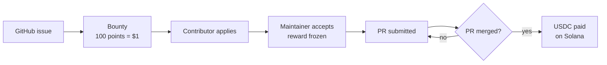
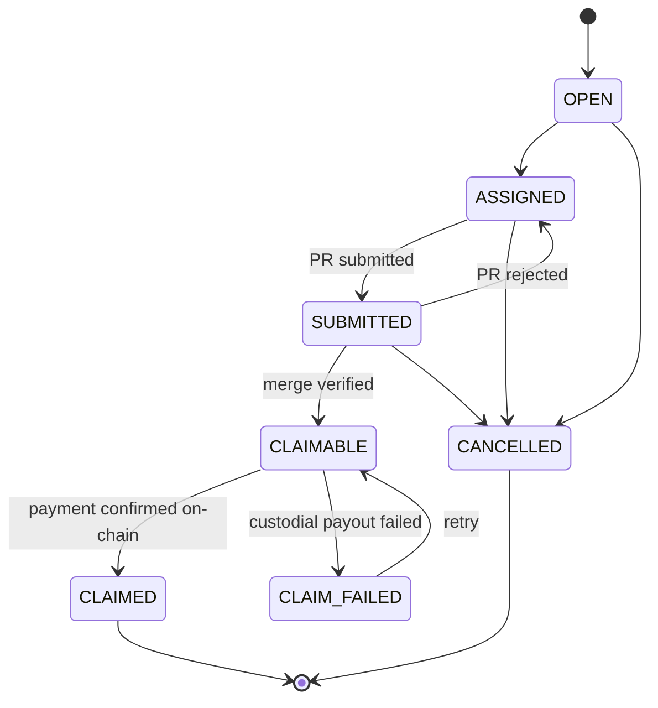

# 🌱 Greenfield

> Turn open source contributions into USDC rewards on Solana.

Greenfield links **GitHub issues** to **bounties**. Maintainers price an issue, contributors apply and open a PR, and a **confirmed merge** pays USDC to the contributor's wallet.



Repository: [github.com/GermanoDevelopment/greenfield](https://github.com/GermanoDevelopment/greenfield)

## Stack

- **Backend:** FastAPI, SQLAlchemy 2 (async), asyncpg, Alembic. Port `8080`.
- **Frontend:** React 19, Vite, TypeScript, Tailwind, `@solana/kit`. Port `5173` (dev) or `3000` (Docker, Nginx).
- **Database:** Postgres 15. Port `5432`.
- **Contract:** Anchor (Rust) escrow program: treasury, per-bounty escrow and contributor claim.

## Quickstart

Requirements: Docker with Compose. For local development also Python 3.12+, [uv](https://docs.astral.sh/uv/) and Node.js 20+.

### Option A: everything in Docker

```bash
docker compose up -d --build
curl http://localhost:8080/api/v1/health
```

Open http://localhost:3000 (app) and http://localhost:8080/docs (Swagger). Migrations run on startup.

```bash
docker compose logs -f backend frontend
docker compose down       # stop, keep data
docker compose down -v    # stop and wipe the local database
```

The Docker frontend is a static build: `VITE_API_URL` is baked in at build time and `frontend/.env` is ignored. It defaults to `http://localhost:8080/api/v1`. After frontend changes, run `docker compose up -d --build frontend`.

### Option B: local development (recommended)

Postgres in Docker, backend and frontend on your machine with hot reload.

```bash
# 1. Database
docker compose up -d postgres

# 2. Backend (terminal 1)
cd backend
cp .env.example .env
uv sync
uv run alembic upgrade head
uv run uvicorn app.main:app --reload --port 8080

# 3. Frontend (terminal 2)
cd frontend
cp .env.example .env
npm install
npm run dev
```

Open http://localhost:5173. The default `DATABASE_URL` in `.env.example` works as is; the backend converts it to `postgresql+asyncpg://`.

### First login

- **Email and password:** sign up in the app's login modal, or `POST /api/v1/auth/register`.
- **GitHub OAuth:** needs `GITHUB_CLIENT_ID` and `GITHUB_CLIENT_SECRET`.

New accounts are always `CONTRIBUTOR`. No admin exists on a fresh instance; an operator provisions one:

- **GitHub admins:** list their usernames in `ADMIN_GITHUB_USERNAMES`. They become `ADMIN` on OAuth login.
- **Email and password admins:** run the CLI. It creates the user, or promotes an existing one, without exposing an HTTP route.

```bash
cd backend
GREENFIELD_ADMIN_PASSWORD='<at least 12 chars>' uv run python -m app.cli create-admin --email ops@example.com --username ops
```

Without `GREENFIELD_ADMIN_PASSWORD` the CLI prompts for the password. Migration `000005` demotes the old `@greenfield.com` seed admins that still have the password `admin123` and disables their password login, so re-provision them with the CLI.

## Configuration

The `.env.example` files work out of the box.

**Backend** (`backend/.env`):

- `ENVIRONMENT`: defaults to `development`. Any other value (for example `production`) makes the backend refuse to start unless `JWT_SECRET` is a random value of at least 32 characters, `GITHUB_WEBHOOK_SECRET` is set, `DATABASE_URL` does not use the default `greenfield:greenfield` credentials, and the GitHub OAuth id and secret are set together.
- `DATABASE_URL`: Postgres connection string. Docker Compose overrides the host to `postgres`.
- `JWT_SECRET`: **change in production**; generate one with `openssl rand -hex 32`. `JWT_EXPIRATION_MINUTES` defaults to `1440`.
- `CORS_ORIGINS`: allowed frontend origins. Defaults to ports `5173` and `3000`.
- `GITHUB_CLIENT_ID`, `GITHUB_CLIENT_SECRET`, `GITHUB_REDIRECT_URI`: GitHub OAuth.
- `GITHUB_WEBHOOK_SECRET`: HMAC secret for the webhook. **Required:** if empty, every webhook is rejected with `403`.
- `GITHUB_TOKEN`: token for GitHub API calls when the user has none. **Set it outside local dev:** submit and complete query the GitHub API, and unauthenticated calls are capped at 60 per hour per IP, after which they fail with `409 Could not verify the pull request on GitHub`.
- `ENABLE_DEV_LOGIN` (default `false`): enables `POST /auth/dev-login`, which logs in as any username with no password, for local demos only. Even when `true`, it stays off while GitHub OAuth is configured. Never enable it on a shared deployment.
- `ADMIN_GITHUB_USERNAMES`: GitHub usernames that become ADMIN on OAuth login. Empty by default.
- `SOLANA_RPC_URL`: defaults to devnet.
- `SOLANA_PROGRAM_ID` and `SOLANA_AUTHORITY_SECRET_KEY`: set both to enable on-chain escrow (see [Payouts](#payouts)).
- `SOLANA_TREASURY_KEYPAIR_PATH` or `SOLANA_TREASURY_PRIVATE_KEY` (base58): treasury key for the custodial fallback.
- `USDC_MINT_DEVNET`: USDC mint used for payouts.
- `RATE_LIMIT_ENABLED` (default `true`): per-IP limits, per minute: `RATE_LIMIT_AUTH_PER_MINUTE` (`10`, for login, register, dev-login and the OAuth callback), `RATE_LIMIT_WEBHOOK_PER_MINUTE` (`120`) and `RATE_LIMIT_GITHUB_PER_MINUTE` (`30`, for routes that call the GitHub API). Over the limit, the API returns `429` with `Retry-After`.
- `LOGIN_MAX_FAILURES` (`5`) and `LOGIN_LOCKOUT_MINUTES` (`15`): after that many failed logins for one email within the window, that email is locked for the window, even with the right password.

Limits are kept in memory per process, so each worker or replica counts separately. Behind a reverse proxy, run uvicorn with `--proxy-headers --forwarded-allow-ips=<proxy ip>` so limits apply to the client IP, not the proxy's.

**Frontend** (`frontend/.env`). Vite reads these at boot, so restart `npm run dev` after changes:

- `VITE_API_URL`: defaults to `http://localhost:8080/api/v1`.
- `VITE_SOLANA_RPC_URL` and `VITE_SOLANA_CHAIN`: default to devnet.
- `VITE_SOLANA_PROGRAM_ID` and `VITE_SOLANA_USDC_MINT`: used to build the contributor's claim transaction. Not in `.env.example` yet.

## How it works



A verified merge moves the bounty to `CLAIMABLE`: the reward is unlocked but not paid yet. It only becomes `CLAIMED` once a payment transaction is confirmed on-chain, and its signature is in `tx_signature`. A failed custodial payout moves it to `CLAIM_FAILED`, with the reason in `claim_error`. `CLAIMED` and `CANCELLED` are final, and a bounty can no longer be cancelled once its merge is verified.

The merge is verified when the GitHub webhook reports a merged PR, or when the issuer or an admin calls `POST /bounties/{id}/complete`. Either way the backend checks the PR on GitHub first.

Rules:

- **Merge required.** If the backend cannot verify the merge, the bounty does not complete.
- **PR bound to the bounty.** On submit and again on merge, the PR must target the issue's repository, be authored by the assigned hunter (matched by GitHub account id, so the hunter needs a linked GitHub account) and reference the issue in its title or body (`#N`, `owner/repo#N` or the issue URL). A PR closed without merge is refused, and one PR can back only one bounty.
- **Frozen reward.** The reward can only change while `OPEN`.
- **One payout per issue.** `complete` is only valid from `SUBMITTED`.
- **Fixed conversion.** `100 points = $1 USDC = 1,000,000 micro-USDC`.

### Payouts

The mode depends on configuration.

**On-chain escrow.** Active when both `SOLANA_PROGRAM_ID` and `SOLANA_AUTHORITY_SECRET_KEY` are set. The Anchor program holds the funds, and the backend runs each step as the bounty advances: create, assign (when the accepted contributor has a wallet), approve on merge, cancel. The contributor then signs `claim` from their wallet in the app. If an on-chain step fails, the database change is rolled back and the API returns an error.

In escrow mode the bounty is `CLAIMABLE` after `approve_claim`, and becomes `CLAIMED` when the contributor reports the claim (`POST /bounties/{id}/claimed`) and the backend finds the on-chain bounty account in the claimed state.

**Custodial fallback.** The default when either variable is missing. On merge the backend records `CLAIMABLE`, then sends SPL USDC from a treasury key straight to the contributor's wallet and waits for confirmation:

- Confirmed: `CLAIMED` with `tx_signature`.
- Any error (RPC rejection, missing funds, confirmation timeout): `CLAIM_FAILED` with `claim_error`, also logged.
- No wallet linked, or no treasury key configured: no attempt, the bounty stays `CLAIMABLE`.

The key comes from `SOLANA_AUTHORITY_SECRET_KEY`, else `SOLANA_TREASURY_KEYPAIR_PATH`, else `SOLANA_TREASURY_PRIVATE_KEY`. With none of them, custodial payouts are off; no key is ever generated. In this mode `POST /bounties/{id}/claimed` is refused, since the backend records its own transactions.

## Commands

```bash
# backend/
uv run uvicorn app.main:app --reload --port 8080
uv run alembic upgrade head
uv run alembic revision --autogenerate -m "message"
uv run pytest                    # in-memory SQLite, no Postgres needed
uv run ruff check .
uv run ruff format --check .

# frontend/
npm run dev
npm run build                    # tsc + build to dist/
npm run preview
npm run lint                     # oxlint

# contract/ (optional)
npm install
anchor build
npm test
```

The contract wallet is `~/.config/solana/id.json`. For devnet: `solana config set --url devnet && solana airdrop 2`. Known inconsistency: `declare_id!` in `lib.rs` is `DFebMWgv4WEJgzodxnQwvXavUeFKXT3mPPMXtMrWyoRv`, but `Anchor.toml` still lists the placeholder `Fg6PaFpoGXkYsidMpWTK6W2BeZ7FEfcYkg476zPFsLnS`.

## API

Everything lives under `/api/v1`:

- Swagger: http://localhost:8080/docs
- ReDoc: http://localhost:8080/redoc
- OpenAPI JSON: http://localhost:8080/openapi.json
- Health: http://localhost:8080/api/v1/health

Route groups: `auth`, `users`, `projects`, `repositories`, `bounties`, `admin`, `webhooks`. Bounty routes are listed in [`backend/README.md`](backend/README.md).

**GitHub webhook.** To complete bounties on merge, point a repository webhook at `POST /api/v1/webhooks/github` with content type `application/json` and the **Pull requests** and **Issues** events. Use the same secret in GitHub and in `GITHUB_WEBHOOK_SECRET`; unsigned or wrongly signed deliveries are rejected with `403`, and so is every delivery while the secret is unset. Admin approval (`POST /admin/bounties/{id}/review`) also requires the PR to be merged on GitHub; there is no override. Deliveries are recorded by `X-GitHub-Delivery`, so a redelivered event is ignored. A merge whose PR no longer meets the binding rules returns `200` with `not completed: <reason>` and leaves the bounty `SUBMITTED`.

## Repository layout

```
greenfield/
├── backend/             # FastAPI app, Alembic migrations, pytest
├── frontend/            # React app (core / infrastructure / presentation)
├── contract/            # Anchor escrow program and integration tests
├── docker-compose.yml   # Postgres + backend + frontend
└── FRONTEND-REQUIREMENTS.md
```

## Troubleshooting

- **Port 5432 or 8080 already in use:** stop the local service or the other container. Find the process with `sudo lsof -i :5432` or `lsof -i :8080`.
- **Backend cannot reach the database:** Postgres may still be starting. Check `docker compose ps` and `docker compose logs postgres`, then rerun `uv run alembic upgrade head`.
- **Migrations say "up to date" but tables are missing:** `DATABASE_URL` points to another database.
- **Frontend shows `Failed to fetch` or a CORS error:** check `VITE_API_URL` and that `curl localhost:8080/api/v1/health` works.
- **`VITE_*` change has no effect:** restart `npm run dev`. In Docker, rebuild with `--build`.
- **`/auth/github/login` fails:** the GitHub OAuth variables are empty. Use email and password in development.
- **Bounty stuck in `CLAIMABLE` (custodial mode):** the contributor has no wallet linked (`PATCH /users/me`), or no treasury key is configured. See [Payouts](#payouts).
- **Bounty in `CLAIM_FAILED`:** the payout was attempted and failed; `claim_error` on the bounty says why (for example `AccountNotFound` when the treasury has no funds).
- **`On-chain transaction failed` (escrow mode):** the Solana step was rejected, so the change was rolled back. Check `SOLANA_PROGRAM_ID`, the authority key balance and `SOLANA_RPC_URL`.
- **Webhook returns `403 Invalid signature`:** `GITHUB_WEBHOOK_SECRET` is empty, or the secret in GitHub differs from it.

Full local reset:

```bash
docker compose down -v
docker compose up -d postgres
cd backend && uv run alembic upgrade head
```
